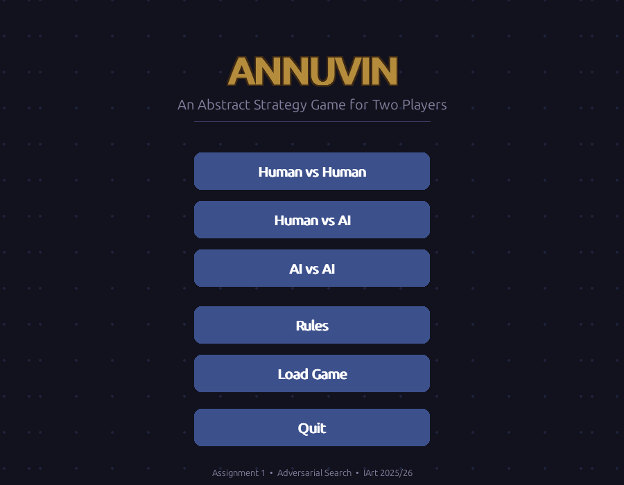
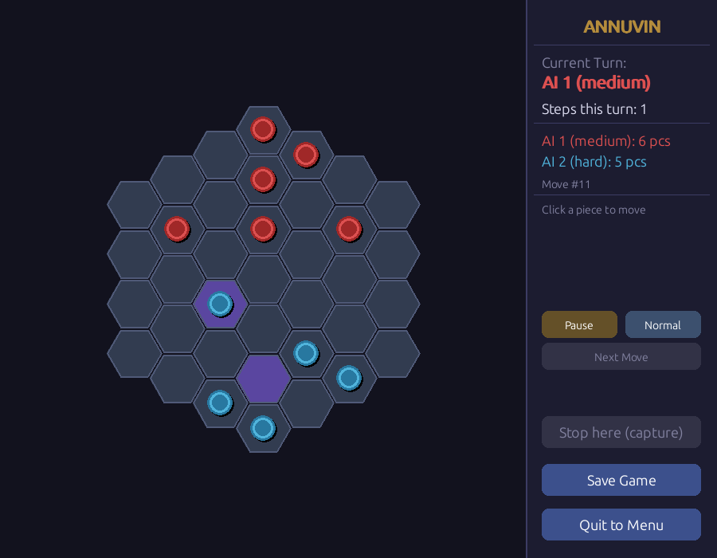
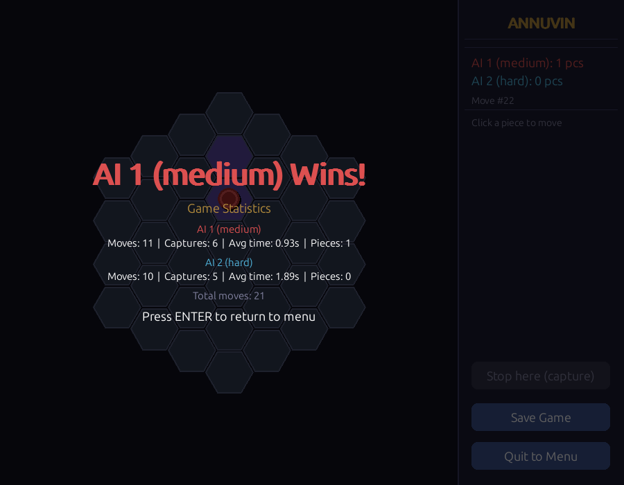

# Annuvin: AI for a Two-Player Board Game

A digital version of the abstract strategy game **Annuvin**, with a **Minimax AI opponent with alpha-beta pruning**, three difficulty levels and an interactive Pygame interface.

Built by a team of 3 for the Artificial Intelligence course (L.EIC, FEUP, 2025/26), Assignment 1: Adversarial Search Methods for Two-Player Board Games. Final grade: **16/20**.

<p align="center">
  
  
  
</p>

## Highlights

- **Minimax with alpha-beta pruning** and an evaluation function built from 7 heuristics
- **3 difficulty levels** (easy, medium, hard) that change search depth, move limits and time limits
- **Human vs Human, Human vs AI and AI vs AI** modes
- **Hint system**: the AI suggests the best move to human players
- **Benchmark tool** that plays AI-vs-AI matches headlessly and compares the difficulty levels

## My contribution

- Worked on the **Minimax AI** with the team
- Built the **hint system**, which computes the best move in the background and highlights it on the board
- Built the **AI vs AI controls** (pause, speed and step-through)
- Wrote the **benchmark tool** (`benchmark.py`) and the project README

## Team

António Miller, Guilherme Linhares, José Reis

---

## Game Description

**Annuvin** is an abstract strategy game played on a HexHex-4 hexagonal board (37 cells). Each player starts with 6 pieces placed in opposite corners.

### Rules

- **Movement:** Each turn, a player moves one piece a number of steps equal to `7 - number_of_pieces`. Fewer pieces means more steps per turn.
- **Captures:** Moving onto a cell occupied by an opponent captures that piece. After a capture, the player may stop early or continue.
- **Win conditions:**
  1. Capture all opponent pieces.
  2. Reduce the opponent to exactly 1 piece while still having all 6 of your own.
- **Draw:** After 150 moves without a winner, the game ends in a draw.

---

## Requirements

- **Python 3.8+**
- **pygame >= 2.5.0**

## Installation

```bash
# Create a virtual environment (recommended)
python3 -m venv .venv
source .venv/bin/activate        # Linux/Mac
# .venv\Scripts\activate         # Windows

# Install dependencies
pip install -r requirements.txt
```

## How to Run

### Game (with GUI)

```bash
python main.py
```

### AI Benchmark (headless, no GUI)

```bash
# Run all difficulty matchups, 10 games each
python benchmark.py

# Custom number of games
python benchmark.py --games 20

# Specific matchups only
python benchmark.py --matchups easy:hard,medium:hard --games 5
```

---

## Game Modes

| Mode | Description |
|------|-------------|
| **Human vs Human** | Two human players take turns |
| **Human vs AI** | Human plays as Player 1 against Minimax AI |
| **AI vs AI** | Two AI players with independently selectable difficulties |

### AI Difficulty Levels

| Parameter | Easy | Medium | Hard |
|-----------|------|--------|------|
| Search depth | 1 | 2 | 3 |
| Root move limit | 12 | 32 | 96 |
| Branch move limit | 6 | 18 | 52 |
| Time limit | 0.15s | 0.90s | 2.50s |

---

## Features

### AI Algorithm: Minimax with Alpha-Beta Pruning

The AI uses Minimax search with alpha-beta cuts. The evaluation function considers 7 heuristic components:

1. **Material** — Piece count advantage (weighted)
2. **Speed** — Step advantage from having fewer pieces
3. **Alternate Win** — Bonus when close to win condition 2 (6 vs 1)
4. **Threat & Safety** — BFS-based analysis of threatened/threatening pieces
5. **Mobility** — Number of valid moves (penalizes being cornered)
6. **Centrality** — Rewards pieces near the board center
7. **Proximity** — Light pull toward enemy pieces (aggression)

### AI vs AI Watchability

In AI vs AI mode, the following controls are available:
- **Pause / Play** — Pause or resume the game
- **Speed control** — Fast (0.3s), Normal (1.0s), Slow (2.0s) delay between moves
- **Step-through** — When paused, advance one move at a time

### Hints for Human Players

In Human vs Human and Human vs AI modes, a **Hint** button suggests the best move (calculated by a medium-difficulty AI in the background). The suggested piece and path are highlighted in gold on the board.

### Game Statistics

At the end of each game, the application displays:
- Number of moves per player
- Captures per player
- Average time per move
- Pieces remaining

Results are automatically exported to `results/game_YYYYMMDD_HHMMSS.txt`.

### Save / Load

Games can be saved and loaded from text files via the in-game menu.

### Benchmark

The `benchmark.py` script runs headless games between AI players and exports detailed performance comparisons to `results/benchmark_YYYYMMDD_HHMMSS.txt`.

---

## Project Structure

```
annuvin/
├── main.py              # Application entry point (GUI)
├── benchmark.py         # AI performance comparison (headless)
├── requirements.txt     # Python dependencies
├── README.md            # This file
├── annuvin/
│   ├── __init__.py
│   ├── constants.py     # Colors, dimensions, enums
│   ├── board.py         # Hexagonal board model (cube coordinates)
│   ├── game.py          # Game rules, move generation, MinimaxAI
│   ├── renderer.py      # Pygame board rendering and interaction
│   ├── menu.py          # Menu screens and dialogs
│   └── rules_screen.py  # In-game rules display
├── logs/                # AI decision logs
├── saves/               # Saved game states
└── results/             # Game results and benchmark exports
```

---

## References

- Annuvin rules: [BoardGameGeek](https://boardgamegeek.com/boardgame/294296/annuvin)
- Minimax algorithm: Russell, S. & Norvig, P. (2021). *Artificial Intelligence: A Modern Approach*, 4th ed., Chapter 5.
- Alpha-beta pruning: Knuth, D. E. & Moore, R. W. (1975). "An analysis of alpha-beta pruning". *Artificial Intelligence*, 6(4), 293-326.
- Pygame: https://www.pygame.org/
- Hexagonal grid reference: Red Blob Games — https://www.redblobgames.com/grids/hexagons/
